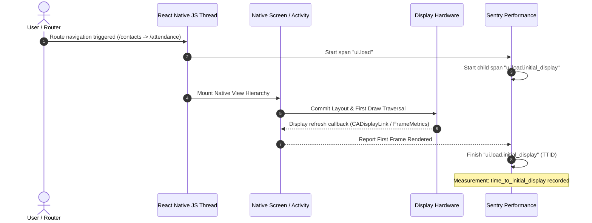
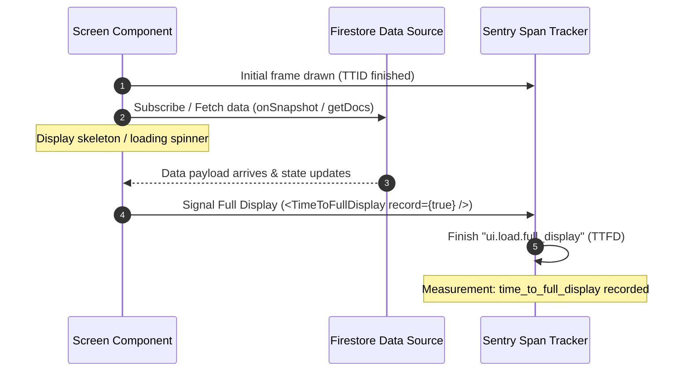

# Research: Mobile (Expo/React Native) TTID and Frame Rate Profiling with Sentry

## Status & Ownership
- **Issue**: [#1684](https://github.com/Shir0o/cisa-campus-work-tracker/issues/1684) — *Research Mobile (Expo/React Native) TTID and frame rate profiling with Sentry*
- **Parent Issue**: [#1677](https://github.com/Shir0o/cisa-campus-work-tracker/issues/1677) — *Map: Daily performance & quality metrics pipeline (Web, PWA, Mobile)*
- **Blocks**: [#1685](https://github.com/Shir0o/cisa-campus-work-tracker/issues/1685) — *Instrument Sentry Performance on Mobile (Android & iOS)*
- **Date**: October 2026
- **Target Platform**: Mobile (Expo SDK 54, React Native 0.81.5, Expo Router v6, New Architecture Fabric/TurboModules, Hermes Engine, iOS & Android)

---

## 1. Executive Summary

This research establishes the architecture and configuration guidelines for instrumenting performance profiling, Time to Initial Display (TTID), Time to Full Display (TTFD), native frame rate metrics (slow and frozen frames), and Hermes JavaScript thread latency within `apps/mobile` using `@sentry/react-native`.

The key architectural decisions and findings are:
1. **Expo Router Integration & Root Layout Wrapping**:
   - In modern Sentry React Native SDK (v8.12+), Sentry provides `Sentry.expoRouterIntegration({ enableTimeToInitialDisplay: true })`, which automatically binds to Expo Router's internal store without requiring manual `useNavigationContainerRef` or `registerNavigationContainer` hook wiring.
   - For backwards compatibility with the current `@sentry/react-native: ~7.2.0` in `apps/mobile/package.json`, `Sentry.reactNavigationIntegration()` can be wired with `useNavigationContainerRef()` inside `app/_layout.tsx`. Upgrading `@sentry/react-native` to `^8.31.0` is strongly recommended for first-class Expo Router support and cleaner startup behavior.
   - Wrapping `RootLayout` via `Sentry.wrap(RootLayout)` is essential for Sentry to accurately calculate cold and warm App Start durations (`app.start.cold`, `app.start.warm`) and to attach top-level render error boundaries.
2. **Time to Initial Display (TTID) & Time to Full Display (TTFD)**:
   - **TTID** is tracked automatically by Sentry as child spans (`ui.load.initial_display`) within screen navigation transactions using native first-frame draw callbacks (`time_to_initial_display`). It does not consume extra transaction quota.
   - **TTFD** cannot be guessed automatically and requires explicit instrumentation. By rendering `<Sentry.TimeToFullDisplay record={!loading} />` or invoking manual span completions once critical async data (e.g., Firestore contacts/queue query) resolves, Sentry measures `time_to_full_display` with an automatic 30-second safety timeout.
3. **Native Slow and Frozen Frames Monitoring**:
   - `enableNativeFramesTracking: !isRunningInExpoGo()` enables native hardware frame monitoring across both mobile operating systems:
     - **iOS**: Uses `CADisplayLink` via Sentry's native Cocoa `SentryFramesTracker` to record rendering latency per frame against the 60Hz (16.67ms) or 120Hz ProMotion (8.33ms) cadence.
     - **Android**: Uses Android's `Window.OnFrameMetricsAvailableListener` / `FrameMetricsAggregator` (API 24+) to measure frame render times against 16.0ms (or device refresh rate).
     - **Frozen Frames Threshold**: Both platforms strictly treat frames taking longer than **700ms** as frozen frames, matching Google Play Android Vitals and Apple App Store hang standards.
4. **Hermes JS Thread Latency & Profiling**:
   - **Stall Tracking**: `enableStallTracking: true` runs a high-resolution interval on the JS event loop, capturing `stall_count`, `stall_total_time`, and `stall_longest_time` whenever the JS thread is blocked for $>100\text{ms}$.
   - **Hermes CPU Profiling**: Configured via `profilesSampleRate: 0.2` (relative to `tracesSampleRate: 0.2`) in production and `1.0` in development. It leverages `hermesProfilingIntegration` to sample Hermes VM bytecode execution and native threads without native bridge bottlenecks.
5. **Inert Gating & Zero Startup Penalties**:
   - Preserves complete compatibility with existing Jest test suites (`apps/mobile/src/lib/sentry.test.ts`) and local DSN-less runs by maintaining lazy module loading (`require('@sentry/react-native')`) inside `apps/mobile/src/lib/sentry.ts`.
   - Exports a safe higher-order component `wrapRootLayout<T>(Component: T): T` that acts as a pure identity passthrough when `EXPO_PUBLIC_SENTRY_DSN` is absent, introducing 0ms overhead, 0 mock dependencies in Jest, and 0 warnings.
   - Prevents native module crashes inside Expo Go by guarding native features with `!isRunningInExpoGo()`.
6. **Strict Legal & Regulatory Compliance (AGENTS.md Rule 6)**:
   - **Session Replay Strictly Prohibited**: Mobile session replay (`mobileReplayIntegration`, `replaysSessionSampleRate`) is completely omitted, eliminating California Invasion of Privacy Act (CIPA) wiretapping liabilities.
   - **PII Scrubbing**: `sendDefaultPii: false`, scrubbing breadcrumbs for sensitive inputs, and strictly limiting user tracking to opaque Firebase `uid`s (never emails, names, or phone numbers).

---

## 2. Primary Sources & Citations

1. **Sentry React Native SDK Official Documentation**:
   - Expo Guide: [Sentry Expo Setup & Configuration](https://docs.sentry.io/platforms/react-native/manual-setup/expo/)
   - Expo Router Integration: [Expo Router Support](https://docs.sentry.io/platforms/react-native/integrations/expo-router/)
   - Performance Monitoring: [Set Up Performance Tracing in React Native](https://docs.sentry.io/platforms/react-native/performance/)
   - Mobile Vitals: [Time to Display (TTID & TTFD)](https://docs.sentry.io/product/insights/mobile-vitals/time-to-display/)
   - Screen Rendering: [Slow and Frozen Frames](https://docs.sentry.io/product/insights/mobile-vitals/screen-rendering/)
   - Profiling with Hermes: [Profiling React Native with Hermes](https://docs.sentry.io/platforms/react-native/profiling/)
2. **Upstream Source Code (`getsentry/sentry-react-native`)**:
   - `expoRouterIntegration`: Added in release `8.12.0` (PR [#3822](https://github.com/getsentry/sentry-react-native/pull/3822)) providing automatic Expo Router store detection.
   - `SentryFramesTracker` (Cocoa): Uses `CADisplayLink` for frame timestamps on iOS.
   - `SentryFrameMetricsCollector` (Android): Uses `Window.OnFrameMetricsAvailableListener` on Android 7.0+ (API 24).
   - JS Stall Tracker: `stalltracking.ts` interval-based event loop lag detector.
   - `TimeToFullDisplay`: React component dispatching full display status to active UI load transaction span.
3. **Expo & React Native Architecture**:
   - Expo SDK 54 / React Native 0.81.5: [Expo SDK 54 Release Notes](https://expo.dev/changelog)
   - Expo Router v6: File-based routing with Stack / Tabs architecture.
   - React Native New Architecture: Fabric renderer and TurboModules enabled (`newArchEnabled: true` in `app.json`).
4. **Existing Codebase Conventions & Compliance**:
   - Existing Mobile Sentry Lib: [`apps/mobile/src/lib/sentry.ts`](file:///Users/twang/.gemini/antigravity/worktrees/cisa-campus-work-tracker/add_performance_metrics_dashboard/apps/mobile/src/lib/sentry.ts)
   - Existing Mobile Sentry Test: [`apps/mobile/src/lib/sentry.test.ts`](file:///Users/twang/.gemini/antigravity/worktrees/cisa-campus-work-tracker/add_performance_metrics_dashboard/apps/mobile/src/lib/sentry.test.ts)
   - Mobile App Entry: [`apps/mobile/app/_layout.tsx`](file:///Users/twang/.gemini/antigravity/worktrees/cisa-campus-work-tracker/add_performance_metrics_dashboard/apps/mobile/app/_layout.tsx)
   - Web Sentry Research: [`docs/research/web-sentry-performance.md`](file:///Users/twang/.gemini/antigravity/worktrees/cisa-campus-work-tracker/add_performance_metrics_dashboard/docs/research/web-sentry-performance.md)
   - Legal & Privacy Policy: [`AGENTS.md`](file:///Users/twang/.gemini/antigravity/worktrees/cisa-campus-work-tracker/add_performance_metrics_dashboard/AGENTS.md) (Section 6: Legal & Regulatory Compliance)

---

## 3. Expo Router Integration & Root Layout Wrapping

### 3.1 The Two Approaches: v7 Manual vs. v8 First-Class

The project currently declares `"@sentry/react-native": "~7.2.0"` in `apps/mobile/package.json`. There are two architectural pathways for integrating navigation tracing with Expo Router:

| Feature / Dimension | Approach A: `@sentry/react-native` v8+ (Recommended) | Approach B: `@sentry/react-native` v7 (Current) |
| :--- | :--- | :--- |
| **Integration API** | `Sentry.expoRouterIntegration()` | `Sentry.reactNavigationIntegration()` |
| **Navigation Ref** | **Automatic**: Internal Expo Router store listener | **Manual**: Requires `useNavigationContainerRef()` + `useEffect` |
| **Lifecycle Binding** | Hooks directly into Expo Router routing events | Must wait for React component mount & ref hydration |
| **Cold Start Timing** | Measures early layout transitions reliably | Minor risk of missing the initial route transition before `useEffect` |
| **Maintenance** | Official standard supported across Expo SDK 52/53/54 | Deprecated pattern requiring extra boilerplate in `app/_layout.tsx` |

#### Recommended Action: Upgrade to `@sentry/react-native: ^8.31.0`
Upgrading `@sentry/react-native` to `^8.31.0` aligns mobile with Expo SDK 54, React Native 0.81, and modern Sentry performance integrations while eliminating fragile ref registration logic.

However, both patterns must support complete fail-safe no-op behavior when Sentry is unconfigured.

---

### 3.2 The Safe Root Layout Wrapper Pattern (`wrapRootLayout`)

In React Native, `Sentry.wrap(RootComponent)` serves two vital functions:
1. It injects a global Error Boundary around the component tree.
2. It hooks into the root component's mount lifecycle to **finalize the App Start transaction** (`app.start.cold` or `app.start.warm`). Without `Sentry.wrap`, Sentry cannot calculate accurate cold start durations or correlates them with the initial screen transition.

#### The Problem: DSN-less Runs and Jest Tests
Calling `Sentry.wrap(RootLayout)` unconditionally when `@sentry/react-native` is not initialized or when running Jest unit tests causes:
- Warning: `Sentry.wrap was called before Sentry.init`.
- Warning: `App Start Span could not be finished`.
- Heavy native TurboModule / JNI linkage attempts during headless Jest runs, breaking `npm test`.

#### The Solution: Lazy Identity Wrapper in `apps/mobile/src/lib/sentry.ts`
By implementing `wrapRootLayout` in `apps/mobile/src/lib/sentry.ts`:

```typescript
import type * as SentryModule from '@sentry/react-native';
import React from 'react';

let Sentry: typeof SentryModule | null = null;

/**
 * Higher-order component wrapping the root layout.
 * If Sentry is active, applies Sentry.wrap to complete app start tracing.
 * If Sentry is inactive (no DSN or Jest test), returns the component untouched (identity function).
 */
export function wrapRootLayout<P extends object>(
  Component: React.ComponentType<P>
): React.ComponentType<P> {
  if (!Sentry) {
    return Component;
  }
  return Sentry.wrap(Component);
}
```

This guarantees:
- **Zero test regressions**: In Jest tests, `Sentry` is `null`, and `wrapRootLayout(RootLayout)` immediately returns `RootLayout` without calling Sentry native code.
- **Zero startup penalty**: When `EXPO_PUBLIC_SENTRY_DSN` is empty, no Sentry wrapper wraps the React tree.

---

### 3.3 Wiring Navigation Instrumentation

#### Implementation with v8 (`expoRouterIntegration`)
Inside `apps/mobile/src/lib/sentry.ts`:
```typescript
import { isRunningInExpoGo } from 'expo';
import type * as SentryModule from '@sentry/react-native';

export function initSentry(): void {
  if (Sentry) return;
  const dsn = process.env.EXPO_PUBLIC_SENTRY_DSN;
  if (!dsn) return;

  try {
    const mod = require('@sentry/react-native') as typeof SentryModule;
    const isExpoGo = isRunningInExpoGo();

    mod.init({
      dsn,
      environment: process.env.EXPO_PUBLIC_APP_ENV || 'production',
      tracesSampleRate: process.env.NODE_ENV === 'development' ? 1.0 : 0.2,
      profilesSampleRate: process.env.NODE_ENV === 'development' ? 1.0 : 0.2,

      // Performance & Frame Tracking
      enableAppStartTracking: true,
      enableNativeFramesTracking: !isExpoGo,
      enableStallTracking: true,
      enableUserInteractionTracking: true,

      // Expo Router first-class integration
      integrations: [
        mod.expoRouterIntegration({
          enableTimeToInitialDisplay: !isExpoGo,
        }),
      ],

      // Privacy & compliance (see Section 7)
      sendDefaultPii: false,
      beforeBreadcrumb: sanitizeBreadcrumb,
      beforeSend: sanitizeEvent,
    });

    Sentry = mod;
  } catch {
    Sentry = null;
  }
}
```

#### Implementation with v7 (`reactNavigationIntegration`)
If staying temporarily on v7:
```typescript
// apps/mobile/src/lib/sentry.ts
let navIntegration: any = null;

export function initSentry(): void {
  ...
  navIntegration = mod.reactNavigationIntegration({
    enableTimeToInitialDisplay: !isRunningInExpoGo(),
  });
  mod.init({
    ...
    integrations: [navIntegration],
  });
}

export function registerNavigationRef(ref: any): void {
  if (navIntegration && ref) {
    navIntegration.registerNavigationContainer(ref);
  }
}
```
And in `apps/mobile/app/_layout.tsx`:
```tsx
const ref = useNavigationContainerRef();
useEffect(() => {
  if (ref) {
    registerNavigationRef(ref);
  }
}, [ref]);
```

---

## 4. Time to Initial Display (TTID) and Time to Full Display (TTFD)

### 4.1 How Time to Initial Display (TTID) Works Under the Hood

TTID measures the elapsed time from when a user or router triggers a screen navigation until the **very first frame** of that screen is displayed on the device hardware.



#### Native Detection Mechanics:
1. **iOS**:
   - The Sentry Cocoa SDK attaches a `CADisplayLink` observer through `SentryFramesTracker`.
   - When the `UIViewController` transition begins, the tracker monitors for the first display hardware refresh tick.
   - Upon the first callback tick, the timestamp is captured, the TTID child span completes, and the one-shot observer detaches.
2. **Android**:
   - The Sentry Android SDK hooks into `ActivityLifecycleCallbacks` and the window's `ViewTreeObserver.OnDrawListener` or `Choreographer.postFrameCallback`.
   - Once the view hierarchy traverses its first draw pass, the initial display timestamp is locked in.
3. **App Launch Alignment**:
   - During cold app starts, Sentry automatically adjusts the TTID starting point to align with the process launch (`pre-main` on iOS, `Application.onCreate` on Android), accounting for engine and layout boot latency.
4. **Zero Quota Overhead**:
   - TTID is stored as a child span (`ui.load.initial_display`) within the parent `ui.load` transaction and as a measurement attribute (`time_to_initial_display`). It does not create separate billable transactions.

---

### 4.2 How Time to Full Display (TTFD) Works

While TTID is captured automatically as soon as the skeleton or initial UI appears, **TTFD** measures when the screen is *actually usable and fully hydrated* with dynamic data.

Sentry cannot predict when background network requests or Firestore snapshot deliveries finish. Therefore, **TTFD must be instrumented explicitly**.



#### Safety Deadlines & Timeouts:
- If `<TimeToFullDisplay record={false} />` remains false or the app never signals completion, Sentry enforces a **30-second timeout deadline**. After 30 seconds, Sentry closes the transaction and discards or caps the TTFD metric to prevent runaway open transactions.

#### Safe Component Wrapper (`SentryTimeToFullDisplay`)
To prevent crashes or mock requirements in Jest and DSN-less environments, export a safe wrapper in `apps/mobile/src/lib/sentry.ts`:

```typescript
// apps/mobile/src/lib/sentry.ts
export function SentryTimeToFullDisplay(props: { record: boolean }): React.ReactElement | null {
  if (!Sentry) return null;
  const Component = Sentry.TimeToFullDisplay;
  return Component ? React.createElement(Component, props) : null;
}
```

#### Usage in Screen Components
In `apps/mobile/app/(tabs)/index.tsx` (My Day / Contacts list):
```tsx
import { SentryTimeToFullDisplay } from '../../src/lib/sentry';

export default function MyDayScreen() {
  const { contacts, loading } = useContacts();

  return (
    <View style={styles.container}>
      {/* Automatically reports TTFD when loading flips to false */}
      <SentryTimeToFullDisplay record={!loading} />
      
      {loading ? <SkeletonList /> : <ContactFlatList data={contacts} />}
    </View>
  );
}
```

---

## 5. Native Slow and Frozen Frames Monitoring

### 5.1 Industry Standards & Sentry Thresholds

UI smoothness on mobile devices is governed by the display refresh cycle:
- Standard displays run at **60 Hz** ($\approx 16.67\text{ ms}$ per frame).
- Apple ProMotion and Android 120Hz displays run at **120 Hz** ($\approx 8.33\text{ ms}$ per frame).

Sentry classifies frame delivery into three buckets during all active screen transactions:

| Metric | Target Duration | Threshold | User Experience Impact |
| :--- | :--- | :--- | :--- |
| **Normal Frame** | $\le 16.67\text{ ms}$ (60Hz) / $\le 8.33\text{ ms}$ (120Hz) | Frame rendered within vsync deadline | Smooth 60/120 FPS animation and scrolling. |
| **Slow Frame (`frames.slow`)** | $> 16.67\text{ ms}$ (iOS) / $> 16.0\text{ ms}$ (Android) | Missed 1+ vsync intervals | Noticeable UI hitch, stuttering scroll, or touch lag. |
| **Frozen Frame (`frames.frozen`)** | $> 700\text{ ms}$ | Frame processing exceeds $700\text{ ms}$ | Severe application freeze. User perceives app as crashed or frozen (ANR precursor). |

> [!NOTE]
> The **700 ms** frozen frame threshold aligns directly with **Google Play Android Vitals** and **Apple Xcode Organizer / App Store Metrics**. Sentry surfaces these metrics directly in its Mobile Vitals dashboard under **Slow Frames %** and **Frozen Frames %**.

---

### 5.2 Operating System Implementation Mechanics

#### iOS (`CADisplayLink` Engine)
- The Sentry Cocoa SDK maintains an active `CADisplayLink` observer registered on the main runloop (`NSRunLoop.mainRunLoop` in `NSRunLoopCommonModes`).
- On every display refresh, `CADisplayLink` provides the timestamp of the last frame and the target refresh rate (`targetTimestamp`).
- If the difference between consecutive frame timestamps exceeds the calculated refresh duration, `frames_slow` increments.
- If the gap exceeds $0.7\text{ seconds}$, `frames_frozen` increments.
- On devices with ProMotion (e.g., iPhone Pro, iPad Pro), the SDK reads `maximumFramesPerSecond` to dynamically set the slow frame threshold to $8.33\text{ ms}$.

#### Android (`Window.OnFrameMetricsAvailableListener`)
- On Android 7.0+ (API level 24 and above), Sentry registers an `OnFrameMetricsAvailableListener` on the window attached to the active `Activity`.
- This provides hardware-level timing breakdowns directly from the Android graphics pipeline:
  - `TOTAL_DURATION`
  - `LAYOUT_MEASURE_DURATION`
  - `DRAW_DURATION`
  - `SYNC_DURATION`
  - `COMMAND_ISSUE_DURATION`
  - `SWAP_BUFFERS_DURATION`
- If `TOTAL_DURATION` exceeds $16\text{ ms}$, it is recorded as a slow frame; if it exceeds $700\text{ ms}$, it is counted as a frozen frame.
- On older Android APIs, Sentry gracefully falls back to `Choreographer.FrameCallback`.

---

### 5.3 Transaction Metrics & Sentry Dashboard Surfacing

Every transaction captured in `apps/mobile` (e.g., navigation to `/contacts`, `/attendance`, `/queue`) receives the following telemetry tags:

```json
{
  "measurements": {
    "frames_total": 450,
    "frames_slow": 8,
    "frames_frozen": 0,
    "frames_slow_rate": 0.0177,
    "frames_frozen_rate": 0.0
  }
}
```

In the Sentry dashboard:
1. **Screen Summary**: Displays the percentage of frozen and slow frames per route.
2. **Suspect Functions**: If profiling is active, Sentry highlights the exact JavaScript or native function that executed during the frame drop.

---

## 6. Hermes JS Thread Latency & CPU Profiling

### 6.1 JavaScript Event Loop Stall Tracking (`enableStallTracking`)

In React Native, UI unresponsiveness frequently stems from synchronous execution blocking the single-threaded JavaScript engine (Hermes).

#### How Sentry Detects JS Stalls:
- When `enableStallTracking: true` is configured, Sentry runs a dedicated timer loop on the JavaScript event loop using `setInterval` or `setImmediate` with an expected tick interval of $100\text{ ms}$.
- If synchronous code blocks the Hermes JS thread (e.g., sorting 5,000 contact records, rendering a deep unmemoized component tree, or parsing a massive JSON payload), the timer cannot fire on time.
- Upon eventual execution, Sentry measures the discrepancy between expected firing time and actual execution time:
  $$\text{Stall Duration} = \text{Actual Time} - \text{Expected Time}$$
- If $\text{Stall Duration} > 100\text{ ms}$, a stall is recorded.

#### Metrics Recorded on Spans:
- `stall_count`: Number of stalls during the span/transaction.
- `stall_total_time`: Cumulative stalled duration in milliseconds.
- `stall_longest_time`: The longest single stall event.

---

### 6.2 Hermes Bytecode Profiling (`profilesSampleRate`)

Starting with React Native 0.70+ and standard in Expo SDK 54, the Hermes engine features a built-in sampling profiler.

#### Configuration:
```typescript
Sentry.init({
  ...
  tracesSampleRate: 0.2, // 20% of transactions traced
  profilesSampleRate: 1.0, // 100% of traced transactions receive Hermes CPU profiles
});
```
*(Note: `profilesSampleRate` is relative to `tracesSampleRate`. In production, $0.2 \times 1.0 = 20\%$ total transaction profiling, preserving quotas).*

#### Profiling Mechanics:
- Sentry's `hermesProfilingIntegration` invokes Hermes VM native C++ hooks (`HermesSamplingProfiler::enable()`).
- The profiler samples the call stack at high frequency ($\approx 1000\text{ Hz}$ or every $1\text{ ms}$) with negligible overhead ($< 1\text{–}2\%$).
- The resulting trace generates interactive flamegraphs in Sentry, showing exact function execution times down to the line number.
- Sentry correlates slow and frozen frames directly with the Hermes CPU flamegraph, pinpointing the code responsible for frame drops.

---

## 7. Privacy, Legal Compliance & CIPA Safeguards

### 7.1 Strict Prohibition of Session Replay (AGENTS.md Rule 6)

`AGENTS.md` explicitly mandates:
> **CIPA / Wiretapping (Session Replay)**: Do not add session recording/replay scripts (Clarity, FullStory, LogRocket) without explicit opt-in. Mask all input fields at the capture layer.

Sentry provides Mobile Session Replay (`mobileReplayIntegration`) in recent SDKs. Enabling this without strict opt-in creates statutory wiretapping liability under the California Invasion of Privacy Act (CIPA).

#### Enforcement in `apps/mobile`:
- **DO NOT** install or import `@sentry-internal/replay` or mobile replay packages.
- **DO NOT** enable `mobileReplayIntegration()`.
- **DO NOT** set `replaysSessionSampleRate` or `replaysOnErrorSampleRate`.
- Ensure mobile telemetry strictly captures metrics, traces, and sanitized breadcrumbs.

---

### 7.2 Preventing PII Leakage in Breadcrumbs & Tags

The mobile application handles sensitive pastoral care data, student phone numbers, email addresses, and personal notes. Under no circumstances may this data leak into Sentry telemetry.

#### 1. Disable Default PII
```typescript
sendDefaultPii: false,
```
Prevents Sentry from collecting device identifiers, IP addresses, or environment usernames.

#### 2. Breadcrumb Input Sanitization (`beforeBreadcrumb`)
Sanitize touch inputs and navigation breadcrumbs to prevent logging typed form values:
```typescript
function sanitizeBreadcrumb(breadcrumb: SentryModule.Breadcrumb): SentryModule.Breadcrumb | null {
  // Redact form inputs and text entries
  if (breadcrumb.category === 'ui.click' || breadcrumb.category === 'ui.input' || breadcrumb.category === 'touch') {
    if (breadcrumb.data) {
      delete breadcrumb.data.value;
      delete breadcrumb.data.text;
    }
  }

  // Scrub URLs in network breadcrumbs
  if (breadcrumb.category === 'xhr' || breadcrumb.category === 'fetch') {
    if (breadcrumb.data?.url) {
      try {
        const [base] = breadcrumb.data.url.split('?');
        breadcrumb.data.url = base; // Strip query parameters
      } catch {
        // Fallback
      }
    }
  }

  return breadcrumb;
}
```

#### 3. User Identity Governance
When attaching authenticated user context (e.g., in `apps/mobile/src/lib/AuthProvider.tsx`), only pass the opaque Firebase `uid`:
```typescript
// Correct: Opaque UID only
if (user) {
  Sentry.setUser({ id: user.uid });
} else {
  Sentry.setUser(null);
}
```
**NEVER** attach:
- `email: user.email`
- `username: user.displayName`
- `phone: user.phoneNumber`

In `beforeSend`, guarantee any accidental user identity fields are stripped:
```typescript
function sanitizeEvent(event: SentryModule.Event): SentryModule.Event | null {
  if (event.user) {
    delete event.user.email;
    delete event.user.username;
    delete event.user.ip_address;
  }
  return event;
}
```

---

## 8. Custom Mobile Firestore Telemetry

### 8.1 Objective
Firestore point queries and initial subscription snapshot deliveries are the primary latency drivers on mobile devices on variable cellular networks.

### 8.2 Safe Mobile Span Helper Implementation (`measureMobileFirestore`)
Add a lightweight telemetry helper to `apps/mobile/src/lib/sentry.ts`:

```typescript
export interface MobileFirestoreSpanOptions {
  op: 'db.query' | 'db.mutation' | 'db.subscribe';
  collection: string;
  operation: string;
  metadata?: Record<string, string | number | boolean>;
}

/**
 * Measure execution latency of a Firestore operation on mobile.
 * If Sentry is not initialized, passes through directly with zero overhead.
 */
export async function measureMobileFirestore<T>(
  options: MobileFirestoreSpanOptions,
  action: () => Promise<T>
): Promise<T> {
  if (!Sentry) {
    return action();
  }

  return Sentry.startSpan(
    {
      name: `Firestore: ${options.collection} [${options.operation}]`,
      op: options.op,
      attributes: {
        'db.system': 'firestore',
        'db.collection': options.collection,
        'db.operation': options.operation,
        ...options.metadata,
      },
    },
    async (span) => {
      try {
        const result = await action();
        span?.setStatus({ code: 1 }); // OK
        return result;
      } catch (err: any) {
        span?.setStatus({
          code: 2, // ERROR
          message: err?.code || err?.message || 'Firestore error',
        });
        throw err;
      }
    }
  );
}
```

---

## 9. Comprehensive Implementation Architecture (`apps/mobile`)

### 9.1 Sentry Module (`apps/mobile/src/lib/sentry.ts`)

```typescript
import { isRunningInExpoGo } from 'expo';
import type * as SentryModule from '@sentry/react-native';
import React from 'react';

let Sentry: typeof SentryModule | null = null;

function sanitizeBreadcrumb(breadcrumb: SentryModule.Breadcrumb): SentryModule.Breadcrumb | null {
  if (breadcrumb.category === 'ui.click' || breadcrumb.category === 'ui.input' || breadcrumb.category === 'touch') {
    if (breadcrumb.data) {
      delete breadcrumb.data.value;
      delete breadcrumb.data.text;
    }
  }
  if (breadcrumb.category === 'xhr' || breadcrumb.category === 'fetch') {
    if (breadcrumb.data?.url) {
      try {
        const [base] = breadcrumb.data.url.split('?');
        breadcrumb.data.url = base;
      } catch {}
    }
  }
  return breadcrumb;
}

function sanitizeEvent(event: SentryModule.Event): SentryModule.Event | null {
  if (event.user) {
    delete event.user.email;
    delete event.user.username;
    delete event.user.ip_address;
  }
  return event;
}

/** Call once at app start. Inert if EXPO_PUBLIC_SENTRY_DSN is absent. */
export function initSentry(): void {
  if (Sentry) return;
  const dsn = process.env.EXPO_PUBLIC_SENTRY_DSN;
  if (!dsn) return;

  try {
    const mod = require('@sentry/react-native') as typeof SentryModule;
    const isExpoGo = isRunningInExpoGo();

    mod.init({
      dsn,
      environment: process.env.EXPO_PUBLIC_APP_ENV || 'production',
      tracesSampleRate: process.env.NODE_ENV === 'development' ? 1.0 : 0.2,
      profilesSampleRate: process.env.NODE_ENV === 'development' ? 1.0 : 0.2,

      // Performance & Frame Tracking
      enableAppStartTracking: true,
      enableNativeFramesTracking: !isExpoGo,
      enableStallTracking: true,
      enableUserInteractionTracking: true,

      // Expo Router First-Class Integration
      integrations: [
        mod.expoRouterIntegration({
          enableTimeToInitialDisplay: !isExpoGo,
        }),
      ],

      // Privacy & compliance (AGENTS.md Rule 6)
      sendDefaultPii: false,
      beforeBreadcrumb: sanitizeBreadcrumb,
      beforeSend: sanitizeEvent,
    });

    Sentry = mod;
  } catch {
    Sentry = null;
  }
}

/** Wrap root component to complete app start and route tracing. */
export function wrapRootLayout<P extends object>(
  Component: React.ComponentType<P>
): React.ComponentType<P> {
  if (!Sentry) return Component;
  return Sentry.wrap(Component);
}

/** Safe component signaling Time to Full Display. */
export function SentryTimeToFullDisplay(props: { record: boolean }): React.ReactElement | null {
  if (!Sentry) return null;
  const Component = Sentry.TimeToFullDisplay;
  return Component ? React.createElement(Component, props) : null;
}

/** Update user context with opaque Firebase UID only. */
export function setSentryUser(uid: string | null): void {
  if (!Sentry) return;
  if (uid) {
    Sentry.setUser({ id: uid });
  } else {
    Sentry.setUser(null);
  }
}

/** Report Firestore operation failure. */
export function captureFirestoreError(info: {
  error: string;
  operationType: string;
  path: string | null;
  userId?: string | null | undefined;
}): void {
  if (!Sentry) return;
  Sentry.captureException(new Error(info.error), {
    tags: {
      operationType: info.operationType,
      path: info.path ?? '',
      userId: info.userId ?? '',
    },
  });
}
```

---

### 9.2 Root Layout Integration (`apps/mobile/app/_layout.tsx`)

```tsx
import { initSentry, wrapRootLayout } from '../src/lib/sentry';

// Fire error and performance reporting up before anything else can throw
initSentry();

function RootLayout() {
  return (
    <GestureHandlerRootView style={{ flex: 1 }}>
      <SafeAreaProvider>
        <AuthProvider>
          <LanguageProvider>
            <ThemeProvider>
              <BottomSheetModalProvider>
                <RootNavigator />
              </BottomSheetModalProvider>
            </ThemeProvider>
          </LanguageProvider>
        </AuthProvider>
      </SafeAreaProvider>
    </GestureHandlerRootView>
  );
}

// Wrap with Sentry.wrap (safe no-op identity when DSN is absent)
export default wrapRootLayout(RootLayout);
```

---

## 10. Verification & Test Plan

1. **Inert Gating Test (`apps/mobile/src/lib/sentry.test.ts`)**:
   - Assert `initSentry()` does not throw when `EXPO_PUBLIC_SENTRY_DSN` is undefined.
   - Assert `wrapRootLayout(Component)` returns the identical component reference when Sentry is inactive.
   - Assert `SentryTimeToFullDisplay({ record: true })` renders `null` without throwing.
   - Assert `setSentryUser('test-uid')` is a safe no-op.
2. **PII Sanitization Unit Tests**:
   - Test `sanitizeBreadcrumb` strips `value` and `text` from `ui.click` and `touch` events.
   - Test `sanitizeBreadcrumb` strips query parameters from `fetch`/`xhr` URLs.
   - Test `sanitizeEvent` removes `email`, `username`, and `ip_address` from `event.user`.
3. **Build & Typecheck Gates**:
   - `npm run typecheck` across root and `apps/mobile`.
   - EAS local build dry run (`eas build --local --platform android --profile preview`) ensuring `@sentry/react-native/expo` plugin does not fail during gradle sync.

---

## 11. Implementation Checklist for Blocking Issue #1685

When implementing [#1685](https://github.com/Shir0o/cisa-campus-work-tracker/issues/1685) (*Instrument Sentry Performance on Mobile (Android & iOS)*):

- [ ] **Step 1: Upgrade SDK (Optional / Recommended)**: Upgrade `@sentry/react-native` to `^8.31.0` in `apps/mobile/package.json` for first-class `expoRouterIntegration`. If staying on `7.2.0`, implement the `useNavigationContainerRef` registration hook.
- [ ] **Step 2: Update `apps/mobile/src/lib/sentry.ts`**:
  - Add performance configuration (`enableAppStartTracking`, `enableNativeFramesTracking`, `enableStallTracking`, `profilesSampleRate`).
  - Add `expoRouterIntegration({ enableTimeToInitialDisplay: !isRunningInExpoGo() })`.
  - Add `wrapRootLayout`, `SentryTimeToFullDisplay`, and `setSentryUser`.
  - Add PII sanitization filters (`sendDefaultPii: false`, `beforeBreadcrumb`, `beforeSend`).
- [ ] **Step 3: Update `apps/mobile/app/_layout.tsx`**:
  - Export `default wrapRootLayout(RootLayout)`.
- [ ] **Step 4: Instrument Key Screens for TTFD**:
  - Add `<SentryTimeToFullDisplay record={!loading} />` to `app/(tabs)/index.tsx` (My Day) and `app/(tabs)/queue.tsx` (Trainee Queue).
- [ ] **Step 5: Bind User Identity in AuthProvider**:
  - In `apps/mobile/src/lib/AuthProvider.tsx`, call `setSentryUser(user ? user.uid : null)` upon auth state change.
- [ ] **Step 6: Update Tests**:
  - Expand `apps/mobile/src/lib/sentry.test.ts` to assert zero exceptions for all new helpers without a DSN and verify PII stripping logic.
