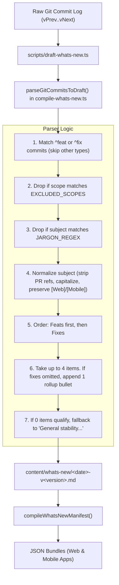

# Automated Curation and Simplification of In-App "What's New" Release Notes

* **Author:** Antigravity / EGM
* **Status:** Approved
* **Date:** 2026-11-09

--------------------------------------------------------------------------------

## Overview

This feature simplifies and curates the in-app "What's New" release notes (`content/whats-new/` and the Release Nudge dialog) produced by the automated release pipeline. By introducing a deterministic filtering, capping, and rollup mechanism into `src/scripts/compile-whats-new.ts` (`parseGitCommitsToDraft`, invoked by `scripts/draft-whats-new.ts`), the system will automatically produce clean, scannable, user-focused release highlights (capped at 4 primary items plus at most 1 rollup summary bullet) and collapse minor improvements into a single friendly line, completely eliminating internal developer jargon, dependency upgrades, and security vulnerability terms without manual human curation.

## The Problem

Currently, `scripts/draft-whats-new.ts` pulls raw git commits between release tags and calls `parseGitCommitsToDraft` to transform commits prefixed with `feat:` or `fix:` into user-facing bullet points and frontmatter `lines:` for the Release Nudge. 

This causes several major issues:
1. **Excessive Length and Cognitive Overload**: Release notes routinely contain 10–20+ items, burying impactful user changes under minor refactors or edge-case adjustments.
2. **Technical Jargon and Internal Mechanics**: End users are exposed to raw technical artifacts, library names, and internal CVE terms (such as `minimatch`, `glob`, `slugNamePart` [an internal URL routing helper], and `polynomial ReDoS`) that are irrelevant to application users and harm trust.
3. **Broken Human-in-the-Loop Assumption**: The pipeline originally assumed maintainers would manually polish drafts before release; however, due to tight delivery cadences, unedited drafts ship directly to production.

## Goals

* **Deterministic Filtering**: Automatically exclude commits with maintenance scopes (`chore`, `deps`, `ci`, `test`, `build`, `refactor`, `style`, `internal`, `security`) and technical jargon/security CVE keywords (e.g. `minimatch`, `ReDoS`, `slugNamePart`, `vite`, `vitest`, `eslint`, `regex`, `ruleset`, `emulator`, `playwright`, `nullish`, `firestore rules`).
* **Strict Highlight Capping**: Limit specific user-facing highlights to a maximum of `MAX_PRIMARY_ITEMS = 4` bullet points (features prioritized first, then fixes).
* **Friendly Summary Rollup**: When eligible fixes or improvements exceed available slots, append exactly 1 synthesized catch-all bullet (`- General bug fixes and stability improvements`), reaching at most 5 bullets total.
* **Fallback Empty State**: If a release contains exclusively internal chores/dependencies (0 items qualify), output a clean fallback highlight (`- General stability and performance improvements`) and matching frontmatter.
* **Nudge Frontmatter Alignment**: Populate the YAML frontmatter `lines:` with up to 4 clean, user-friendly sentences directly from the curated highlights.
* **100% Offline & Deterministic**: Zero network requests, zero external LLM dependencies, keeping drafting fast, free, and stable in CI.
* **Comprehensive Test Coverage**: Unit tests covering filtering rules, cap boundaries, fallback states, and rollup behavior in `src/test/compileWhatsNew.test.ts`.

## Non-Goals

* Modifying the developer-facing changelog or GitHub releases generated by `release-please`.
* Introducing external AI or LLM API calls to the build/release workflow.
* Altering the UI presentation or components of the What's New modal or Release Nudge dialog.

## Open Questions

None.

## Critical User Journeys (CUJs)

### CUJ 1: Release Tag Triggers Automated Draft
* **Given**: A newly published release tag with 15 conventional commits (including 2 features, 3 user bug fixes, 4 dependency chore bumps, and 6 minor developer tweaks).
* **When**: `.github/workflows/draft-whats-new.yml` executes `npx tsx scripts/draft-whats-new.ts --version <version>`.
* **Then**: The generated markdown in `content/whats-new/` contains at most 5 highlight bullets (2 features + 2 top fixes + 1 rollup bullet for remaining fixes), excludes dependency bumps and jargon. Frontmatter `lines:` contains 4 clean sentences ready for the Release Nudge.

### CUJ 2: End User Views In-App Release Notes
* **Given**: An end user updates the application to the new version and opens the app.
* **When**: The Release Nudge appears and the user taps "What's New".
* **Then**: The user reads a concise, jargon-free list of meaningful changes that describe feature capabilities and bug fixes in plain English.

--------------------------------------------------------------------------------

## Technical Plan (Architecture)

### Architectural Flow

`scripts/draft-whats-new.ts` acts as the CLI runner which retrieves the git commit range and passes commit lines to `parseGitCommitsToDraft` in `src/scripts/compile-whats-new.ts`.

### Component Details

1. **Scope and Jargon Filtration**:
   - Commits not matching `^feat(?:\(([^)]+)\))?:` or `^fix(?:\(([^)]+)\))?:` (e.g. `chore:`, `perf:`, `docs:`, `ci:`) are skipped naturally.
   - For matched commits, if `scope = match[1]?.toLowerCase()` matches `EXCLUDED_SCOPES = new Set(['deps', 'chore', 'ci', 'test', 'build', 'refactor', 'style', 'internal', 'security'])`, drop the commit.
   - Case-insensitive regex matching internal dev terminology:
     `JARGON_REGEX = /\b(minimatch|redos|slugnamepart|regex|vitest|vite|eslint|playwright|emulator|ruleset|nullish|firestore\s*rules|typedef|polyfill|linter|lockfile)\b/i`
2. **Prioritization and Capping Rules**:
   - `MAX_PRIMARY_ITEMS = 4`.
   - Take all `feats` up to `MAX_PRIMARY_ITEMS`.
   - If slots remain, take `fixes` up to the remaining capacity.
   - If any eligible `fixes` were displaced/omitted due to the cap, append:
     `- General bug fixes and stability improvements`
   - If 0 total items qualify (e.g. purely internal release), output:
     `- General stability and performance improvements`
3. **Release Nudge Synchronization**:
   - `lines:` in YAML frontmatter takes up to 4 clean sentences from the finalized bullets (stripping markdown `- ` and trailing punctuation, formatted with a trailing `.`).

--------------------------------------------------------------------------------

## Alternatives Considered

### Alternative A: AI/LLM-Based Summarization via GitHub Action
* **Description**: Call an LLM API during the `draft-whats-new.yml` workflow to rewrite commits into marketing-style release notes.
* **Pros**: Can rephrase technical commits into friendly English contextually.
* **Cons**: Introduces external API token costs, secrets management, latency, rate limits, non-determinism, and network failure modes to CI.
* **Reason for Rejection**: 95% of user release notes clarity can be achieved with fast, deterministic TypeScript rules at zero cost and zero network risk.

### Alternative B: Mandatory Manual Editing by Release Maintainers
* **Description**: Maintain the status quo where the script dumps raw commits, and require a human to edit every release PR before merging.
* **Pros**: No changes to the codebase.
* **Cons**: Breaks down in practice. Release maintainers have limited time and often merge drafts directly, resulting in leaked jargon on production releases.
* **Reason for Rejection**: The automated default must be production-ready out-of-the-box.

--------------------------------------------------------------------------------

## Non-Functional Requirements

* **Performance & Latency**: `parseGitCommitsToDraft` runs synchronously in <10ms for hundreds of commits.
* **Rollout & Backward Compatibility**: Fully backward compatible with existing markdown files in `content/whats-new/`. The change only affects newly generated drafts.
* **Security & Privacy**: No network requests or external token consumption; zero user data processed.

--------------------------------------------------------------------------------

## Detailed Implementation Plan

### Target Files to Create/Modify

#### 1. `src/scripts/compile-whats-new.ts` (Modify)
* **Type / Scope**: TypeScript Module / Build Utility
* **Proposed Changes**:
  - Update `parseGitCommitsToDraft(commitLines, meta)`:
    - Define `EXCLUDED_SCOPES = new Set(['deps', 'chore', 'ci', 'test', 'build', 'refactor', 'style', 'internal', 'security'])`.
    - Define `JARGON_REGEX = /\b(minimatch|redos|slugnamepart|regex|vitest|vite|eslint|playwright|emulator|ruleset|nullish|firestore\s*rules|typedef|polyfill|linter|lockfile)\b/i`.
    - Filter commits:
      - Match against `^feat(?:\(([^)]+)\))?:\s*(.+)$/i` or `^fix(?:\(([^)]+)\))?:\s*(.+)$/i`.
      - Drop if `scope && EXCLUDED_SCOPES.has(scope.toLowerCase())`.
      - Drop if `JARGON_REGEX.test(desc)`.
    - Normalize text: strip `(#\d+)`, capitalize first character, prepend `[Mobile] ` / `[Web] ` tag if scoped to platform.
    - Partition into `feats` and `fixes`.
    - Select primary items (up to 4 items: `feats` first, then `fixes`).
    - Determine if rollup bullet is needed: if total eligible fixes > 0 and fixes were omitted, append `- General bug fixes and stability improvements`.
    - Handle empty state: if 0 bullets, fallback to `['- General stability and performance improvements']`.
    - Populate frontmatter `lines:` with up to 4 clean sentences from the resulting items.

#### 2. `src/test/compileWhatsNew.test.ts` (Modify)
* **Type / Scope**: Unit Test Suite
* **Proposed Changes**:
  - Add test case: Exclude commits with maintenance scopes (`feat(deps): ...`, `fix(ci): ...`, etc.).
  - Add test case: Exclude commits containing jargon keywords (`minimatch`, `redos`, etc.).
  - Add test case: Cap primary highlights to 4 items and add rollup bullet when fixes are truncated.
  - Add test case: Fallback to general stability bullet when all commits are filtered out.
  - Add test case: Verify YAML frontmatter `lines:` accurately reflects the curated items.

### Verification Plan

* **Unit Tests**: `npx vitest run src/test/compileWhatsNew.test.ts`
* **Static Analysis**: `npm run typecheck && npm run lint`
* **Build & Seam Checks**: `npm run check:seams && npm run build`

--------------------------------------------------------------------------------

*Drafted with EGM*
